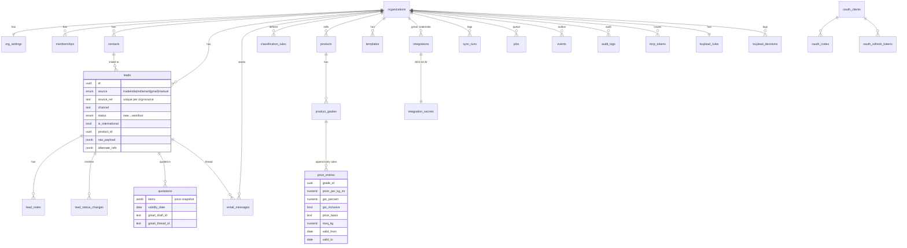

# Architecture

## Layers

```
 Browser (Next.js App Router pages, server actions)      Claude (claude.ai / Code / Cowork)      Supabase pg_cron
            │                                                     │ MCP over HTTPS                       │ every 10 min
            ▼                                                     ▼                                      ▼
   src/app/(app)/**/actions.ts                        src/app/api/mcp/route.ts                 src/app/api/cron/tick
            │                                          (OAuth 2.1 / bearer auth)               (x-cron-secret)
            └──────────────┬──────────────────────────────────────┴──────────────────────────────────────┘
                           ▼
            SERVICE LAYER  src/modules/<module>/service.ts
            defineService(): zod input → permission → one transaction → audit row + domain events
                           │
                           ▼
            Postgres (Supabase, schema `app`, RLS on every table) ◄── humans run as role `authenticated`
                           ▲                                          system/MCP run as owner, org-scoped
            External APIs: Gmail REST (read + drafts), TradeIndia inquiry API
```

**Every action goes through the service layer.** The web UI, the MCP tools and the cron jobs all call the same functions, and permissions, validation, audit and events happen only there. ESLint enforces the boundaries:
- UI code can't import `@/db` or any schema.
- A module can't import another module's `schema`.

## Folder layout

```
src/
  app/                    Next.js routes
    (app)/                signed-in pages: dashboard, leads, review, rates, templates, indiamart, settings
    api/mcp               MCP endpoint;  api/oauth/{register,token}; api/well-known/* (rewritten from /.well-known)
    api/cron/tick         background sync entry point
    api/integrations/gmail/callback   Google OAuth redirect
    oauth/authorize       MCP OAuth consent screen
    login, auth/*         Supabase Auth screens
  components/             UI (shadcn-style primitives in components/ui)
  db/                     Drizzle client, withUserTx (RLS) / withSystemTx
  lib/                    env, errors, crypto (AES-GCM), phone (E.164), format (₹, IST), auth, rate limit
  modules/<name>/         schema.ts · service.ts · types.ts · *.test.ts
  server/seed.ts          idempotent seed (org, owner, catalog, rates, templates, rules)
  proxy.ts                session refresh + sign-in redirect (Next 16's middleware)
drizzle/                  SQL migrations (never edit an applied one)
fixtures/emails/          anonymised email samples with expected parse results
seed/<company>/           settings.json, products.json, price-lists/*.txt, price-list-map.json (ADR-025)
scripts/                  local DB, migrations (TCP or Management API), seed, demo data, keys
tests/, e2e/              Vitest integration tests; Playwright smoke tests
```

## Modules

| Module | Owns | Key service functions |
|---|---|---|
| `core` | organizations, org_settings, memberships, audit_logs, events, jobs, integrations, integration_secrets, sync_runs | org settings, members (`members.ts`), integration state and encrypted secrets, backoff, sync runs, job queue, audit reads |
| `contacts` | contacts | `resolveContactInternal` (email → phone dedupe, fill-only) |
| `leads` | leads, lead_notes, lead_status_changes | `upsertLeadInternal` (idempotent + 48h merge), list/get, status, notes, edit, manual lead |
| `email` | email_messages, classification_rules | parsers + `classifyEmail`, `ingestMessageInternal`, review queue, `submitEmailClassification`, rules, reconciliation |
| `sources` | (no tables) | Gmail client, OAuth and sync; TradeIndia client, normaliser and sync; job registry `jobs.ts` |
| `catalog` | products, product_grades, price_entries | current rates (DISTINCT ON), `updateRates` (append-only), history, `matchProduct` |
| `templates` | templates | placeholder engine, defaults, save with validation |
| `quotes` | quotations | `createQuoteDraft` (snapshot → MIME → Gmail draft in thread), WhatsApp text |
| `mcp` | mcp_tokens, oauth_clients, oauth_codes, oauth_refresh_tokens | tokens, OAuth AS, MCP server + tools |
| `buyleads` | buylead_rules, buylead_decisions | rules (full + compact), log decision (cap enforced), summary |
| `dashboard` | (no tables) | one-shot dashboard data, report numbers (`reportInternal`), the daily summary job |
| `backup` | backups | nightly backup of each company to its file storage (rows plus document files, keys left out), 14-day retention, owner-only download, restore into an empty database |
| `documents` | documents | upload (checked by content), list, download, latest valid per type, attachments for quotation drafts; file storage adapter `storage.ts` (Supabase bucket or disk) |
| `outbound` | outgoing_messages, outbound_rules | prepare (template, rates, terms, documents), hold rules, modes, the only send path, Outbox actions, follow-ups (see "Outbound pipeline" below) |
| `ai` | ai_decisions (tier settings are `integrations` rows `ai_basic` / `ai_advanced`) | provider adapters (Gemini, Anthropic, OpenAI-compatible), redaction, task schemas, settings, the `ai.work` job, accuracy (see "AI tiers" below) |

**Common columns** (brief §6.3): every table has `id uuid`, `created_at`, `updated_at` (trigger), `created_by` (actor string `human:<uuid>` / `mcp:<token>` / `system:<job>` / `ai:<tier>`), and `org_id`. `deleted_at` exists where soft delete makes sense.

Two tables are exceptions:
- `organizations` — the org itself.
- `oauth_clients` — registered before an org is chosen.

## Data model



## Lead lifecycle and sources

```
TradeIndia API ──(normalize)──┐
Gmail: TradeIndia email ──────┤ parsers → NormalizedLead → upsertLeadInternal ─► lead (status new)
Gmail: IndiaMART email ───────┤                              │ dedupe: source+source_ref, then phone/email+product ±48h
Gmail: direct inquiry ─► needs_review ─► Claude (MCP) or a person ─► submitEmailClassification ─┘
Manual (phone) ─► createManualLead
```

Every source implements the same three steps: **fetch → normalize to `NormalizedLead` → upsert** (`src/modules/sources/types.ts`). The raw payload is stored so it can be reprocessed later.

## Background jobs

| Job type | What it does | Scheduling |
|---|---|---|
| `gmail.sync` | historyId incremental sync. Falls back to a date resync if the historyId has expired. At most 150 messages per run; the rest wait in a backlog. | enqueued by every tick, and right after connect |
| `tradeindia.sync` | 30-day backfill on first run, then (last success − 2d) → now in 7-day windows | every tick, and after a successful Test connection |
| `indiamart.sync` | One Pull API call per run (ADR-030) | every tick |
| `outbound.plan` | Prepares messages for new leads, buyer replies (documents, or an AI draft held for a person) and follow-ups; only items from the last 48 hours | every tick |
| `outbound.send` | Sends emails the pipeline approved: inside the send window, under the caps, not while paused, after re-checking the rules | every tick |
| `report.daily` | The owner's daily summary email (G-RPT-2), when switched on in Settings → Sending; through the one send path | every tick; sends once a day after 19:30 IST |
| `backup.nightly` | Backs up the company to its file storage and removes backups older than 14 days (G-PLT-7) | every tick; runs once a day after 01:00 IST |
| `leads.rescore` | Refreshes scores of open leads not scored today (MOQs change with rates); 300 per run | every tick; does nothing once the day's pass is done |
| `ai.work` | Leads the rules left open go to Basic, then Advanced, then the review queue; review emails go to Advanced (ADR-031). 15 s budget, 10 items per run; `{ more: true }` queues a follow-up | when a lead or review email arrives that rules could not settle, and every tick |

`/api/cron/tick`:
1. Enqueues every job type above for each org. `dedupe_key` keeps at most one queued job per org per type.
2. Claims due jobs with `SKIP LOCKED`.
3. Runs them. Failures retry with backoff; after 5 attempts the job is `failed`.
4. Integration errors also set `integrations.backoff_until`, and the dashboard shows the last error.

## MCP tool catalogue

The endpoint, authentication and the full tool list are in [`docs/API.md`](API.md). Tools are registered in `src/modules/mcp/server.ts`; each one calls a service and is audited.

## How to extend

### Add a module
1. Create `src/modules/<name>/{schema,service,types}.ts`. Tables go in `app` via `app.table(...)` with `...baseColumns()` and `orgId`.
2. Export the schema from `src/db/schema.ts` and add the module name to `MODULES` in `eslint.config.mjs`.
3. Run `npm run db:generate`, then create a **custom** migration (`npx drizzle-kit generate --custom --name <x>_rls`). It must enable RLS and add policies with `app.is_member` / `app.has_role`, like `drizzle/0001_rls_policies.sql`. Extend `tests/rls.test.ts`.
4. Write services with `defineService`, adding a new permission in `core/permissions.ts` if needed. Call `audit()` and `emit()` in every write.
   - A service that reads or writes a system-only table (`integration_secrets`) needs `runAs: "system"`. The `authenticated` role can never read those tables, so without it the call fails for every signed-in user. Scope every query by `ctx.orgId`.
   - A service that calls an external API (Google, TradeIndia) uses `defineExternalService` and opens short `withSystemTx` transactions itself, so no database connection is held during the network call.
   - Add the new function to `docs/CODEMAP.md`, and test it as a signed-in role in `tests/human-paths.test.ts` (that runs under RLS like the real app).

### Add a lead source (e.g. Justdial, website form)
1. Implement a client and `normalize(raw) → NormalizedLead` in `src/modules/sources/<source>/`, with a unique `sourceRef`.
2. Add a `sync<Source>(ctx)` function modelled on `syncTradeIndia`. It should record a sync run, handle errors and backoff, and call `upsertLeadInternal`.
3. Register the job type in `src/modules/sources/jobs.ts` and enqueue it from `tick()`.
4. If the source also sends notification emails, add a parser in `src/modules/email/parsers/` plus anonymised fixtures in `fixtures/emails/` with `expected` blocks. The fixture test picks them up automatically.
5. Add the enum value to `lead_source` in a new migration (`ALTER TYPE app.lead_source ADD VALUE '…'`).

### Add an export format (roadmap: GST invoice CSV, proforma)
Put formatters in a new `exports` module: `format(quotation | order) → { filename, mime, body }`, one per format, all behind one service `exportDocument(ctx, {kind, id, format})` with permission `exports.run` and an audit row. Formatters are pure functions (easy to unit test). Subscribe to `quote.drafted` or future `order.*` events if generation should be automatic.

### React to events
`events` is an outbox. A future worker reads rows with `processed_at is null` by `type` (e.g. `lead.created` → follow-up reminder), does its work, and sets `processed_at`. Add the handler to `JOB_HANDLERS` and schedule it from `tick()`.

## Adapters for sign-in accounts and files

Two seams keep cloud and local mode on the same code (GOAL G-PLT-6):

- **Sign-in accounts** (`src/lib/accounts.ts`): `accountDirectory().findOrCreate(email)` for Settings → Members. Supabase Auth admin API in cloud mode, the local `auth.users` table in development sign-in. It never sets a password; the person sets their own.
- **File storage** (`src/modules/documents/storage.ts`): `fileStore()` with `put`, `get`, `remove`. The private Supabase bucket `documents` in cloud mode, a folder (`FILE_STORAGE_DIR`) locally. Chosen by `FILE_STORAGE`, else by what is configured.

Backups use the same file store (`backups/<org>/…`), so a local install backs up to its data folder and the cloud to the private bucket.

Both are network calls, so services call them outside database transactions: `inviteMember` creates the account first and then the membership; `uploadDocument` stores the file first, then saves the row, and removes the file if the row cannot be saved.

## AI tiers

```
lead arrives ──► rules (alias match, intent wording, weight units) ──► all settled? ──► done
                                                                        │ no
                                                                        ▼
                         ai.work job: Basic (redacted text) ──► Advanced ──► Leads → Needs details
review email ─────────────────────────────────────────────────► Advanced ──► Emails → Review
```

- A tier is skipped when it is off, has no key, is backing off after a provider error, or has used its daily calls (counted by Inquira in `ai_decisions`). The item moves to the next step in the same run.
- Replies must match a fixed JSON schema (`ai/tasks.ts`); code accepts a field only when it was empty, the value exists and the confidence reaches the company's threshold. AI writes are audited as `ai:basic` / `ai:advanced`; that actor passes no permission check, so a model can never call a public service.
- Basic sees only redacted product and requirement text (`ai/redact.ts`). Buyer text is wrapped in markers it cannot close and the system prompt says it is data.
- Every decision is logged in `ai_decisions`; a person's later change marks it corrected, and the dashboard shows accuracy per tier.
- The Claude connector serves the same review queue with `list_leads_needing_details` and `submit_lead_details` (fills empty fields only).

## Outbound pipeline (ADR-032)

```
lead understood ─┐                          ┌─ held (a reason) ──────────► a person: send anyway / edit / don't send (+ rule)
buyer reply ─────┼─► prepare (template,  ─► │─ draft (shadow, or by a person) ► a person sends (email now; WhatsApp link)
quote sent N days┘    rates, terms, docs)   └─ approved (mode allows) ──► outbound.send: window · caps · pause · re-check ─► sent
```

- Purpose follows the lead: international → acknowledgement; complaint, order, negotiation → an AI draft (held) or a notification; documents → document reply with the latest valid files; sample → sample reply; below MOQ → below-MOQ reply; otherwise the first quotation. Email when the lead has a real email, WhatsApp when it has a phone (G-OUT-5).
- Modes (email): shadow (default), assisted, automatic. WhatsApp is always a person's tap.
- `src/modules/outbound/send.ts` is the only code that sends; a test enforces it.
- Held messages, failed sends and buyer replies are told once under the bell (`notifications`).

## Who may do what

A person's permissions are their role's defaults plus their custom access (`memberships.granted`, `memberships.revoked`), set on Settings → Members → Access as abilities (`ABILITIES` in `src/modules/core/permissions.ts`). Owners always have everything. The app checks permissions in every service (`authorize`); the database checks the same rules again for signed-in people (`app.can`, `drizzle/0008_access_rules.sql`), so a missing check in code cannot write where the person has no permission. Menus show only pages the person may open (`src/components/shell/nav-access.ts`). Claude connector tokens keep their own narrow set (`MCP_PERMISSIONS`).

## Runtime modes

| | Cloud | Local ([`SELF_HOSTING.md`](SELF_HOSTING.md), ADR-029) | Development and tests |
| --- | --- | --- | --- |
| `AUTH_MODE` | `supabase` (default) | `local` | `dev` (refused in production builds) |
| Database | Supabase | Postgres container + shim | local Postgres + shim |
| Accounts (`lib/accounts.ts`) | Supabase Auth admin API | local table + one-time links | local table |
| Files (`documents/storage.ts`) | Supabase Storage | disk volume | temporary folder |
| Scheduler | `pg_cron` → `/api/cron/tick` | `worker` container → `/api/cron/tick` | tests call `tick()` |

